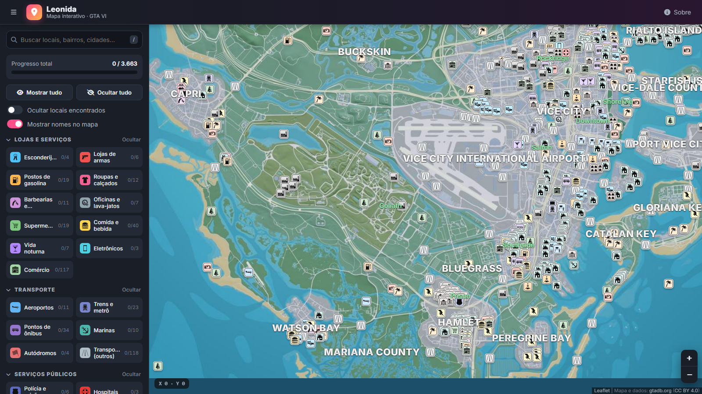
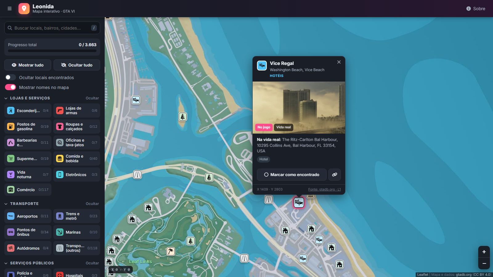
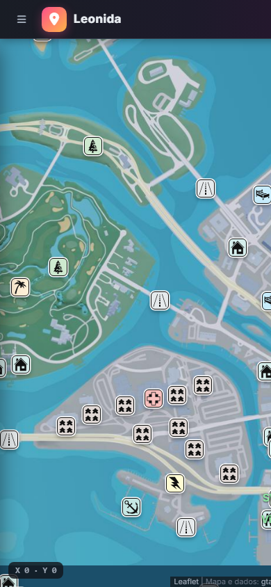
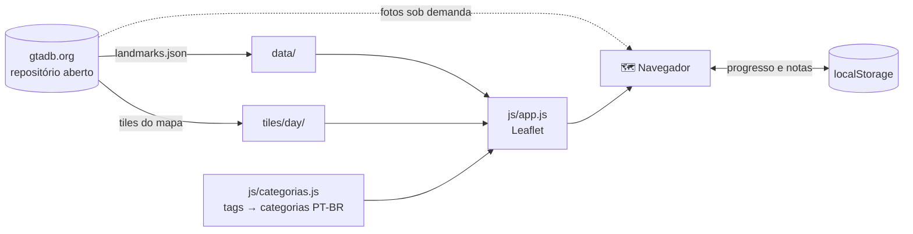

<div align="center">

# 🗺️ Mapa Interativo de Leonida

### O mapa de **GTA VI** em português, direto no navegador

Explore Vice City, as Keys, Grassrivers e o resto de Leonida com mais de **3.600 locais**, busca, fotos, progresso e notas pessoais.

<br>

[](https://thomaslavruhin.github.io/GTA-VI-MAPA-LEONIDA/)

<br>


<br>



</div>

---

## ✨ Funcionalidades

<table>
<tr>
<td width="50%" valign="top">

### 🧭 Navegação
- Mapa com zoom e arraste, em alta resolução
- Ícones que viram pontos quando você se afasta
- Coordenadas do jogo (X/Y) sob o cursor
- **Link compartilhável**: a URL guarda posição e local aberto

### 🔎 Busca
- Por nome, bairro, cidade, categoria ou **endereço real**
- Sem diferenciar acentos (`hotel vice` acha "Hotéis · Vice Beach")
- Atalho <kbd>/</kbd> para buscar e <kbd>Enter</kbd> para abrir o primeiro resultado

</td>
<td width="50%" valign="top">

### 🏷️ Categorias
- **31 categorias** em **4 grupos**, com ícones e cores próprios
- Mostrar e ocultar por categoria, por grupo ou tudo de uma vez
- Contador de encontrados por categoria (`3/19`)

### ✅ Progresso e notas
- **Marcar como encontrado**, com barra de progresso total
- Opção para ocultar os locais já encontrados
- **Notas pessoais** em qualquer ponto do mapa (botão direito ou toque longo), arrastáveis e editáveis
- Tudo salvo no seu navegador, sem login

</td>
</tr>
</table>

<div align="center">
<table>
<tr>
<td align="center" width="68%">
<br>
<sub><b>Popup do local:</b> foto no jogo × vida real, endereço real e tags</sub>
</td>
<td align="center" width="32%">
<br>
<sub><b>No celular:</b> layout responsivo</sub>
</td>
</tr>
</table>
</div>

---

## 📍 O que tem no mapa

<details>
<summary><b>Ver todas as categorias e quantidades</b></summary>
<br>

| Grupo | Categorias |
|---|---|
| 🛍️ **Lojas e serviços** | Esconderijos (4) · Lojas de armas (6) · Postos de gasolina (19) · Roupas e calçados (12) · Barbearias e tatuagens (11) · Oficinas e lava-jatos (7) · Supermercados (19) · Comida e bebida (40) · Vida noturna (7) · Eletrônicos (3) · Comércio (117) |
| ✈️ **Transporte** | Aeroportos (11) · Trens e metrô (23) · Pontos de ônibus (34) · Marinas (10) · Autódromos (4) · Transporte – outros (118) |
| 🏛️ **Serviços públicos** | Polícia e prisões (6) · Hospitais (3) · Governo (50) · Espaços públicos (30) · Infraestrutura (44) |
| 🌴 **Locais** | Pontos turísticos (33) · Hotéis (71) · Lazer e esportes (69) · Natureza (102) · Residências (342) · Escritórios (9) · Indústria (92) · Em construção (13) · Outros locais (2.354) |

> **Outros locais** reúne os pontos ainda sem nome ou tag no banco de dados. A categoria começa oculta para não poluir o mapa; ative-a no painel quando quiser.
>
> Cerca de **2.400 locais têm foto** do jogo, e muitos também têm foto do lugar real que inspirou a construção.

</details>

---

## ⌨️ Atalhos

| Tecla | Ação |
|:---:|---|
| <kbd>/</kbd> | Buscar |
| <kbd>Enter</kbd> | Abrir o primeiro resultado da busca |
| <kbd>M</kbd> | Mostrar ou ocultar o painel |
| <kbd>Esc</kbd> | Fechar popup, foto ou modo de nota |
| Botão direito | Criar nota no ponto clicado |

---

## ⚙️ Como funciona

Site **100% estático**: sem servidor, sem banco de dados e sem build. HTML, CSS e JavaScript puro com [Leaflet](https://leafletjs.com).



- **Coordenadas:** as mesmas do jogo usadas pelo gtadb (de −16384 a 16384). No zoom 0, o mundo inteiro cabe em 4×4 tiles de 256 px.
- **Desempenho:** só os marcadores visíveis na tela são desenhados, então o mapa continua leve mesmo com milhares de pontos.
- **Fotos:** não ficam no repositório. São carregadas sob demanda do GitHub do gtadb quando você abre um local.

### 📁 Estrutura

```
├── index.html              página principal
├── css/estilo.css          visual (tema escuro)
├── js/
│   ├── app.js              lógica do mapa, busca, progresso e notas
│   └── categorias.js       categorias PT-BR e tradução das tags
├── icones/                 ícones das categorias (game-icons.net)
├── data/landmarks.json     locais (gtadb.org)
├── tiles/day/{z}/          tiles do mapa, zoom 0–5 (gtadb.org)
├── docs/                   imagens deste README
└── atualizar-dados.ps1     baixa a versão mais recente dos dados
```

---

## 🚀 Rodar no seu computador

```bash
git clone https://github.com/thomaslavruhin/GTA-VI-MAPA-LEONIDA.git
cd GTA-VI-MAPA-LEONIDA
python -m http.server 8000
```

Depois abra **http://localhost:8000**.

> [!NOTE]
> Abrir o `index.html` direto (`file://`) não carrega os locais, porque o navegador bloqueia a leitura do JSON. Use um servidor local, como o comando acima.

## 🔄 Atualizar os dados

A comunidade do gtadb atualiza o mapa com frequência. Para trazer a versão mais recente dos locais e dos tiles:

```powershell
.\atualizar-dados.ps1
git add -A
git commit -m "Atualiza dados do gtadb"
git push
```

O GitHub Pages republica o site sozinho a cada `push`.

## 🍴 Publicar a sua própria cópia

1. Faça um **fork** deste repositório.
2. Abra **Settings → Pages → Deploy from a branch**, escolha a branch `main` e a pasta `/ (root)`.
3. Em cerca de um minuto o site estará em `https://SEU-USUARIO.github.io/GTA-VI-MAPA-LEONIDA/`.

---

## 🤝 Contribuindo

Sugestões e correções são bem-vindas:

- **Tradução ou categorias:** edite [`js/categorias.js`](js/categorias.js) e abra um *pull request*.
- **Locais errados ou faltando:** os dados vêm do gtadb. Contribua direto no [map.gtadb.org](https://map.gtadb.org) ou no [repositório deles](https://github.com/rolux/gtadb.org), e a correção chega aqui na próxima atualização.
- **Bugs:** abra uma [issue](https://github.com/thomaslavruhin/GTA-VI-MAPA-LEONIDA/issues).

---

## 📜 Créditos e licenças

| O quê | Fonte | Licença |
|---|---|---|
| Locais, fotos e tiles do mapa | [gtadb.org e colaboradores](https://github.com/rolux/gtadb.org) · [map.gtadb.org](https://map.gtadb.org) | [CC BY 4.0](https://creativecommons.org/licenses/by/4.0/deed.pt_BR) |
| Biblioteca de mapas | [Leaflet](https://github.com/Leaflet/Leaflet) | BSD-2-Clause |
| Ícones do mapa | [game-icons.net](https://game-icons.net): Delapouite, Lorc, Skoll, John Colburn, Andy Meneely ([lista completa](icones/CREDITOS.md)) | [CC BY 3.0](https://creativecommons.org/licenses/by/3.0/) |
| Ícones da interface | [Font Awesome Free](https://fontawesome.com) | CC BY 4.0 / SIL OFL 1.1 |
| Fonte | [Inter](https://rsms.me/inter/) via Google Fonts | SIL OFL 1.1 |

**Alterações nos dados do gtadb (exigência da CC BY 4.0):** as tags foram reagrupadas em categorias e traduzidas para o português, e foram incluídos apenas os zooms 0 a 5 do conjunto de tiles "day".

<div align="center">
<br>
<sub>
Grand Theft Auto, GTA VI e Leonida são marcas registradas da Rockstar Games / Take-Two Interactive.<br>
Este é um projeto de fãs, <b>sem afiliação</b> com a Rockstar Games. O mapa é uma reconstrução da comunidade e pode conter imprecisões.
</sub>
<br><br>

Feito com ☕ e muito zoom em Vice City · Se curtiu, deixe uma ⭐

</div>
